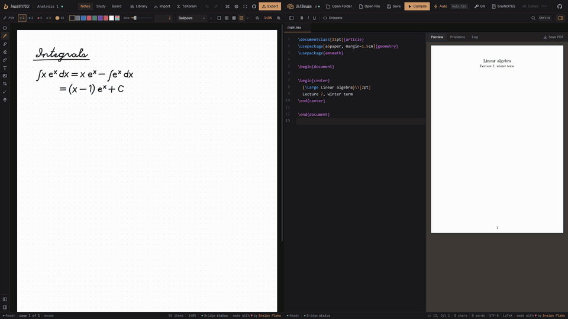

<p align="center">
  
</p>

<h1 align="center">brainBRIDGE</h1>

<p align="center">
  Your handwritten notes, written up in LaTeX by your coding agent.<br/>
  braiNOTES and TeXbrain, connected to Claude Code, Codex, Cursor or VS Code.
</p>

<p align="center">
  
</p>

<p align="center">
  <a href="https://notes.swimmingbrain.dev"><strong>braiNOTES &rarr; notes.swimmingbrain.dev</strong></a><br/>
  <a href="https://tex.swimmingbrain.dev"><strong>TeXbrain &rarr; tex.swimmingbrain.dev</strong></a>
</p>

Your agent reads your handwritten notes, writes them up in LaTeX and compiles them, while you watch it happen in your browser tabs.

[braiNOTES](https://github.com/swimmingbrain/brainotes) is for handwritten notes, [TeXbrain](https://github.com/swimmingbrain/texbrain) is a LaTeX editor, both run entirely in the browser. This is a small MCP server that connects your agent to both tabs at once. It gets tools like `notes_page`, `notes_transcribe`, `tex_write`, `tex_compile` and `tex_pdf_page`: it can look at a page of your notes, turn it into LaTeX, put it into your project, compile it and look at the PDF.

```
you                    your agent                  brainbridge                               your browser tabs
"write up page 3" ───> picks a tool ── stdio ────> this server ── ws://127.0.0.1:7332 ──┬──> braiNOTES
                                                                                        └──> TeXbrain
```

Nothing leaves your machine. The server only listens on the loopback address and the tabs only talk to it. The one exception is transcription with an API key, see below.

## Setup

**1. Build the server** (Node 20 or newer, and `pnpm`):

```bash
git clone https://github.com/swimmingbrain/brainbridge
cd brainbridge
pnpm install
pnpm build
```

**2. Tell your agent about it.** Claude Code, from any terminal:

```bash
claude mcp add brainbridge -- node /absolute/path/to/brainbridge/dist/index.js
```

On Windows the path looks like `C:\Users\you\brainbridge\dist\index.js`. Cursor (`~/.cursor/mcp.json`) and a `.mcp.json` in your project use this:

```json
{
  "mcpServers": {
    "brainbridge": {
      "command": "node",
      "args": ["/absolute/path/to/brainbridge/dist/index.js"]
    }
  }
}
```

VS Code (`.vscode/mcp.json`):

```json
{
  "servers": {
    "brainbridge": {
      "type": "stdio",
      "command": "node",
      "args": ["/absolute/path/to/brainbridge/dist/index.js"]
    }
  }
}
```

Codex: `codex mcp add brainbridge -- node /absolute/path/to/brainbridge/dist/index.js`, or in `~/.codex/config.toml`:

```toml
[mcp_servers.brainbridge]
command = "node"
args = ["/absolute/path/to/brainbridge/dist/index.js"]
```

**3. Open the apps with the bridge on:** https://notes.swimmingbrain.dev/?bridge and https://tex.swimmingbrain.dev/editor?bridge

Chrome and Edge ask once whether the site may connect to apps on your device, allow it. Each app gets a `Bridge` segment in its status bar: amber while it waits for the server, green when it is connected. The switch is remembered. In braiNOTES it lives under Preferences, General, in TeXbrain in the command palette as "Bridge: connect" and "Bridge: disconnect".

`node dist/index.js status` in the brainbridge folder tells you which apps are connected.

## Try these

> Look at page 2 of my Analysis notebook and write it up as LaTeX at the end of main.tex in the analysis project. Compile it and check the PDF.

> Transcribe the last page of my notes to markdown.

> Which formulas on page 4 did I write? Zoom in on the second block.

> Link the Analysis notebook to the analysis project, then switch to the project.

> Put a summary of this page as text under the last line.

## The tools

| Group | Tool | What it does |
|---|---|---|
| Both | `bridge_status` | Which apps are connected and what they have open |
| | `bridge_link`, `bridge_links` | Tie a notebook to a project, in both apps and here |
| | `bridge_switch` | Opens the linked notebook or project in the other app |
| | `latex_check` | Parses every math span of a text with KaTeX and lists the broken ones |
| braiNOTES | `notes_list`, `notes_open`, `notes_create` | The notebooks |
| | `notes_pages`, `notes_goto`, `notes_new_page` | The pages of the open notebook |
| | `notes_page` | A page as an image, with the lines, blocks and drawings found in the strokes |
| | `notes_region` | A part of a page, zoomed in |
| | `notes_strokes` | The raw ink: every stroke with its points |
| | `notes_transcribe` | A page as LaTeX or markdown, exactly as written, optionally right into a TeXbrain file |
| | `notes_add_text`, `notes_add_image` | Typed text and PNG pictures on a page |
| | `notes_export_pdf` | The notebook as a PDF file on your disk |
| TeXbrain | `tex_status`, `tex_projects`, `tex_open`, `tex_create` | The projects stored in the browser |
| | `tex_files`, `tex_read`, `tex_write`, `tex_insert` | The files of the open project, written through the editor |
| | `tex_compile`, `tex_compile_status`, `tex_problems` | Compiles and says what went wrong, with file and line |
| | `tex_pdf_page`, `tex_save_pdf` | A page of the PDF as an image, or the PDF on your disk |

Pages of a notebook count from 0, pages of a PDF from 1. Positions on a page are in page units from the top left, an A4 page is 595 x 842. There is also an MCP prompt `transcribe` with the instructions the transcription uses.

## Transcription

With `ANTHROPIC_API_KEY` set for the server, `notes_transcribe` sends the page and zoomed crops of its formulas to Haiku through the Anthropic API, checks every formula with KaTeX, has the broken ones read again on sharper crops and gives a page that still fails to Sonnet. Without a key it hands the page, its layout and the same instructions to your agent, which then reads the page itself.

The key goes to the server like this: `claude mcp add -e ANTHROPIC_API_KEY=your-key brainbridge -- node /absolute/path/to/brainbridge/dist/index.js`. Only then do page pictures leave your machine, to the Anthropic API.

## Good to know

- **One tab per app.** A second braiNOTES tab takes over from the first one, which says so. A braiNOTES and a TeXbrain tab work side by side.
- **Every edit is one undo step** in the tab, so you can step back through what your agent did.
- **Projects in a folder on your disk** cannot be opened from here, the browser only reaches them through its folder picker. Open the folder in TeXbrain yourself, then the tools work on it.
- **Running the apps locally?** Open `http://localhost:5173/?bridge` or `http://localhost:5173/editor?bridge`, localhost is allowed too.
- **Another port.** Start the server with `--port 7400` (or `BRAINBRIDGE_PORT=7400`) and open the apps with `?bridge=7400`. `BRAINBRIDGE_ORIGINS` adds more page origins that may connect, comma separated.
- **Links** between notebooks and projects are kept in `links.json` in `%APPDATA%\brainbridge` on Windows and `~/.config/brainbridge` elsewhere. Nothing else is stored.

## Development

```bash
pnpm dev     # runs the server from source with tsx
pnpm test    # fake braiNOTES and TeXbrain tabs answer every tool
pnpm smoke   # drives the two real tabs end to end, after pnpm build
```

The wire protocol is `src/protocol.ts`, both apps keep a copy of it in `src/lib/bridge/protocol.ts`.

## License

MIT, see [LICENSE](LICENSE).

Built by [Braian Plaku](https://swimmingbrain.dev)
